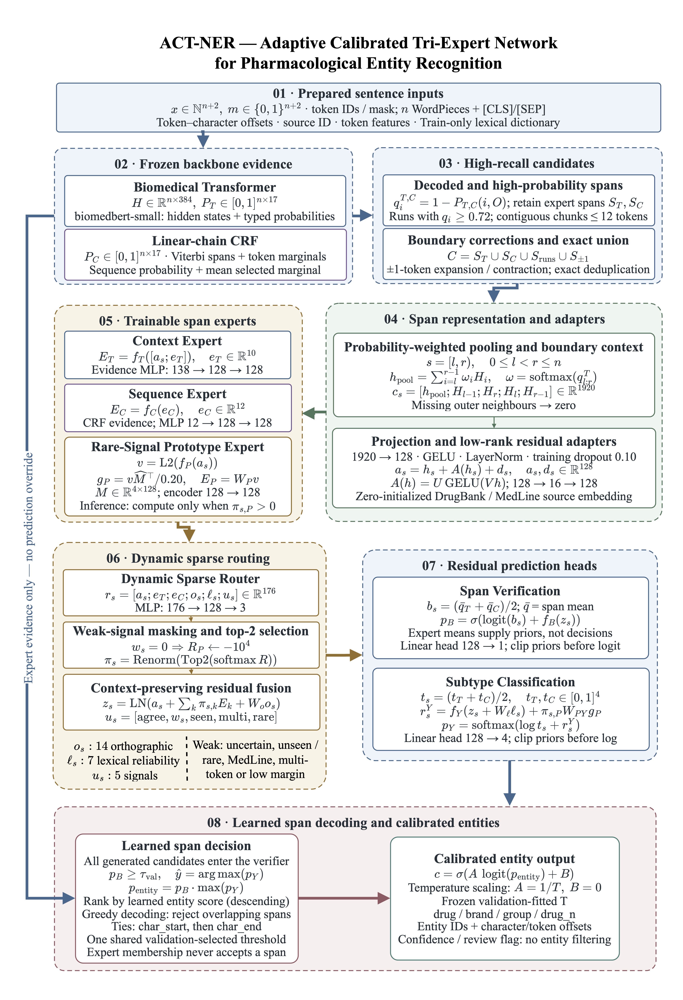
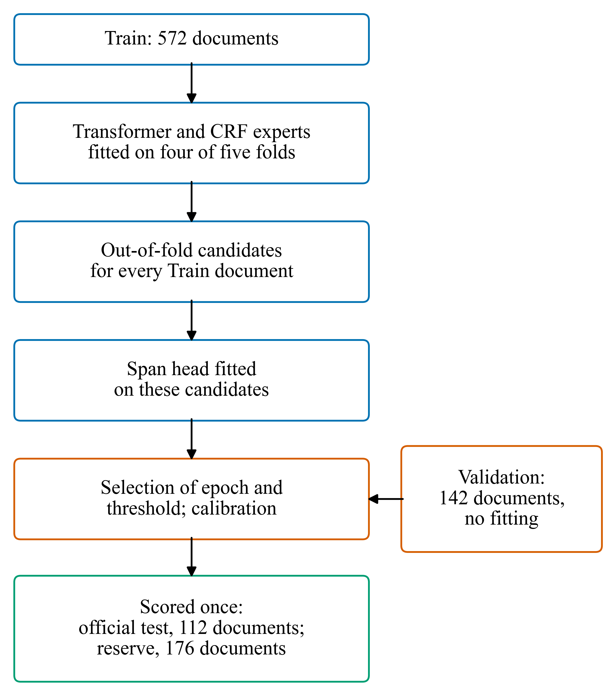
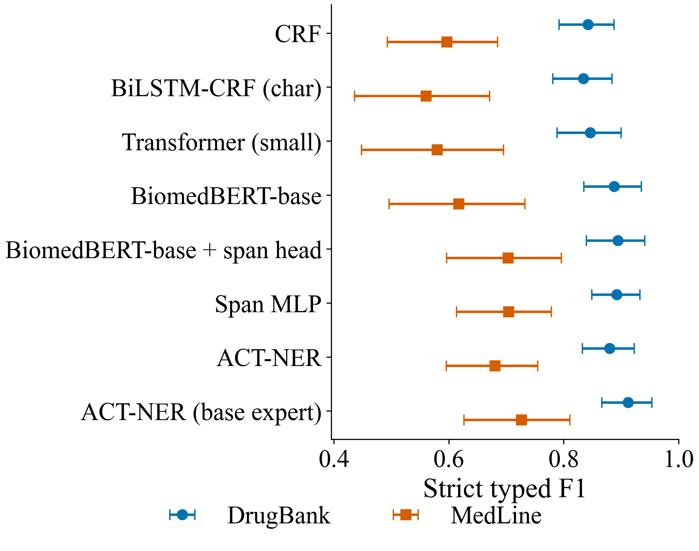
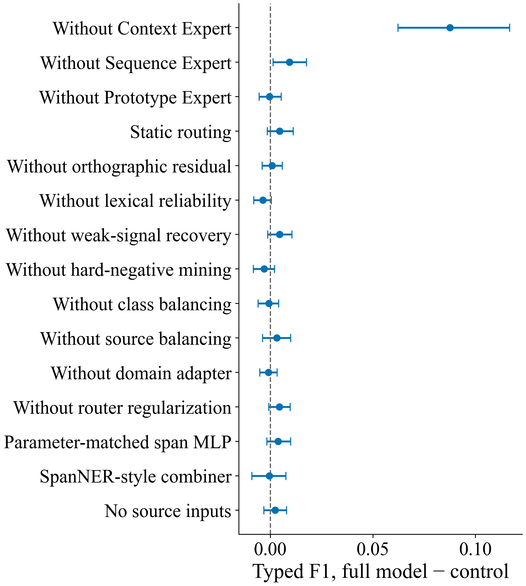
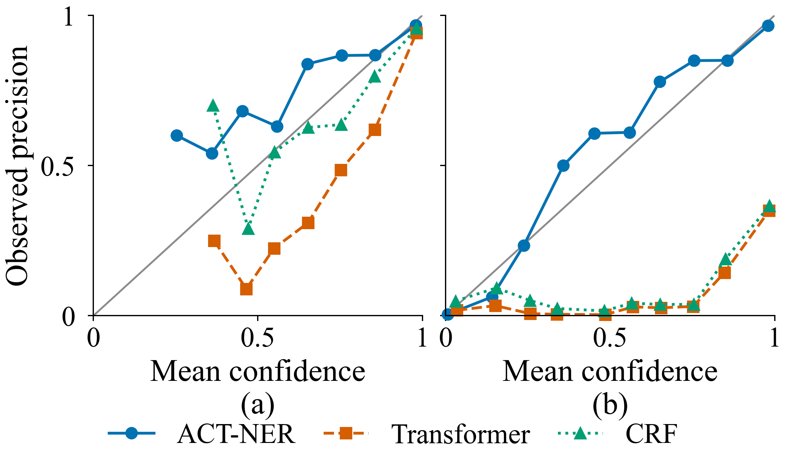

# ACT-NER: Recognition and Typing of Pharmacological Entities

**Span-level verification of pooled Transformer and CRF candidates: an experimental study on DDIExtraction 2013**


This repository contains the code, data, executed notebooks, result tables and figures of an experimental study of
exact-span recognition and four-way typing of pharmacological entities (`drug`, `brand`, `group`, `drug_n`) in
biomedical text. The studied model, **ACT-NER** (Adaptive Calibrated Tri-Expert Network), does not label tokens
directly. It pools the entity candidates proposed by a frozen biomedical Transformer and a linear-chain CRF and
verifies every candidate span with a small routed head that combines a context expert, a sequence expert and a
prototype expert.

## Contents

- [Key findings](#key-findings)
- [Method](#method)
- [Data](#data)
- [Results](#results)
- [Repository structure](#repository-structure)
- [Getting started](#getting-started)
- [Reproducibility](#reproducibility)
- [Limitations](#limitations)
- [Data sources and licence](#data-sources-and-licence)

## Key findings

- **A compact verification head.** The head has 363,291 trainable parameters on top of frozen experts;
  the complete system uses 22,953,262 parameters at inference with the small encoder.
- **Consistent gain over its own experts.** Under a leakage-free stacking protocol, ACT-NER improves strict typed
  F1 (Δ, Holm-adjusted p) over the linear-chain CRF and the fine-tuned small Transformer on Validation
  (+0.0389, p = 0.0016; +0.0412, p = 0.0010) and on the text-disjoint reserve (+0.0503, p = 0.0022; +0.0385, p = 0.0022).
- **Official DrugNER test set.** ACT-NER reaches typed F1 0.7711 [0.7135, 0.8234] (DrugBank 0.8798, MedLine 0.6798).
  With a BiomedBERT-base expert it reaches 0.8075 and improves over fine-tuned BiomedBERT-base
  (+0.0744, p = 0.0022).
- **Where the evidence stops.** On the official test set the differences to the CRF (+0.0617, p = 0.2016) and to the small
  Transformer (+0.0773, p = 0.1260) are positive but do not pass the Holm adjustment. With the small encoder, ACT-NER is
  not statistically separated from fine-tuned BiomedBERT-base, from a parameter-matched span MLP or from a
  SpanNER-style combiner that use the same candidates. Of the head components, only the context expert has a
  supported contribution (Δ typed F1 +0.0876 [0.0621, 0.1166], Holm-adjusted p = 0.0030).
- **Calibration.** The expected calibration error of accepted entities on the official test set is 0.0419 for
  ACT-NER, against 0.2080 for the small Transformer and 0.2048 for BiomedBERT-base.

## Method

<p align="center">
  
</p>

**Figure 1.** Architecture of ACT-NER. A frozen biomedical Transformer and a linear-chain CRF propose entity
spans; the union of their candidates is scored by a span head with three experts and a sparse router; a calibrated
confidence is attached to every accepted entity.

The reference evaluation uses a **stacking protocol** in which no document contributes both to the fitting of an
expert and to the fitting of the head that consumes its predictions:

1. the experts are fitted on five cross-fit folds of Train and produce out-of-fold candidates for every Train document;
2. the span head is fitted on these out-of-fold candidates only;
3. Validation is used for epoch and threshold selection and for calibration, never for fitting;
4. the official DrugNER test set and the reserve documents are scored once with frozen models.

<p align="center">
  
</p>

**Figure 2.** Data flow of the stacking protocol: which documents fit, select, calibrate and evaluate each component.

## Data

The experiments use the DDIExtraction 2013 corpus (SemEval-2013 Task 9), which combines DrugBank descriptions and
MedLine abstracts. The original training documents are split once, at document level, into Train and Validation.
The official DrugNER test set is kept for frozen evaluation. The test documents of the relation-extraction task
serve as an additional reserve after the removal of every document that shares text with the development data.

**Table 1.** Evaluation populations. Eligible gold entities are contiguous annotations with valid offsets;
discontinuous annotations are counted separately and excluded from strict metrics.

| Population | Documents | Sentences | Eligible gold entities | DrugBank | MedLine |
| :--- | :---: | :---: | :---: | :---: | :---: |
| Train | 572 | 5,510 | 11,812 | 10,352 | 1,460 |
| Validation | 142 | 1,466 | 2,915 | 2,544 | 371 |
| Official DrugNER test | 112 | 665 | 684 | 303 | 381 |
| Reserve (text-disjoint) | 176 | 1,174 | 2,717 | 2,196 | 521 |

BC5CDR is used as an external corpus for an architecture-transfer experiment and is downloaded by the code at run time.

## Results

All scores are strict (exact boundaries and type) corpus-level micro-F1. Intervals are percentile 95 % confidence
intervals from 5,000 paired cluster-bootstrap replicates, where a cluster joins documents that share an exact
normalised sentence. Paired comparisons use two-sided randomisation tests with 5,000 swaps and Holm adjustment
within each comparison family. Models with several optimiser seeds (17, 29, 43) are averaged over seeds.

### Strict typed F1 under the stacking protocol

**Table 2.** Strict typed F1 with 95 % confidence intervals. Systems that were not evaluated on the Validation
folds of this protocol are marked n/a.

| System | Validation (142 documents) | Official DrugNER test (112) | Text-disjoint reserve (176) |
| :--- | :---: | :---: | :---: |
| Linear-chain CRF | 0.8643 [0.8320, 0.8922] | 0.7094 [0.6418, 0.7698] | 0.8422 [0.8115, 0.8713] |
| BiLSTM-CRF with character features | n/a | 0.6775 [0.5955, 0.7518] | 0.8639 [0.8359, 0.8900] |
| Biomedical Transformer (small encoder, fine-tuned) | 0.8620 [0.8341, 0.8863] | 0.6938 [0.6055, 0.7721] | 0.8540 [0.8275, 0.8792] |
| BiomedBERT-base (fine-tuned) | 0.9067 [0.8818, 0.9283] | 0.7331 [0.6503, 0.8101] | 0.8833 [0.8564, 0.9074] |
| BiomedBERT-base + span head (fine-tuned) | n/a | 0.7874 [0.7201, 0.8486] | 0.9140 [0.8944, 0.9307] |
| SpanNER-style combiner | 0.9037 [0.8794, 0.9236] | 0.7646 [0.6839, 0.8331] | 0.8929 [0.8700, 0.9126] |
| Parameter-matched span MLP | 0.8994 [0.8745, 0.9211] | 0.7903 [0.7305, 0.8402] | 0.9006 [0.8784, 0.9198] |
| **ACT-NER** | 0.9032 [0.8788, 0.9240] | 0.7711 [0.7135, 0.8234] | 0.8925 [0.8704, 0.9119] |
| **ACT-NER, BiomedBERT-base expert** | n/a | 0.8075 [0.7452, 0.8624] | 0.9197 [0.9012, 0.9357] |

On the official test set with the task denominators (686 annotations), ACT-NER has precision 0.8093,
recall 0.7342 and strict F1 0.7699.

### Official test set by source

**Table 3.** Strict typed F1 on the official DrugNER test set by source, and macro-F1 over the four entity types.

| System | DrugBank | MedLine | Macro-F1 over types |
| :--- | :---: | :---: | :---: |
| Linear-chain CRF | 0.8421 [0.7913, 0.8870] | 0.5962 [0.4926, 0.6845] | 0.5961 [0.5370, 0.6626] |
| BiLSTM-CRF with character features | 0.8343 [0.7804, 0.8838] | 0.5601 [0.4357, 0.6704] | 0.5604 [0.5024, 0.6213] |
| Biomedical Transformer (small encoder, fine-tuned) | 0.8462 [0.7882, 0.8998] | 0.5791 [0.4476, 0.6950] | 0.5919 [0.5242, 0.6605] |
| BiomedBERT-base (fine-tuned) | 0.8876 [0.8348, 0.9346] | 0.6172 [0.4958, 0.7318] | 0.6744 [0.6199, 0.7310] |
| BiomedBERT-base + span head (fine-tuned) | 0.8939 [0.8392, 0.9409] | 0.7029 [0.5959, 0.7953] | 0.7367 [0.6538, 0.8022] |
| SpanNER-style combiner | 0.8889 [0.8410, 0.9316] | 0.6587 [0.5282, 0.7683] | 0.6631 [0.6070, 0.7236] |
| Parameter-matched span MLP | 0.8923 [0.8484, 0.9324] | 0.7037 [0.6128, 0.7779] | 0.7521 [0.7068, 0.7887] |
| **ACT-NER** | 0.8798 [0.8323, 0.9223] | 0.6798 [0.5951, 0.7545] | 0.7432 [0.6942, 0.7823] |
| **ACT-NER, BiomedBERT-base expert** | 0.9119 [0.8657, 0.9531] | 0.7260 [0.6257, 0.8102] | 0.7907 [0.7266, 0.8405] |

<p align="center">
  
</p>

**Figure 3.** Strict typed F1 on the official DrugNER test set by source. MedLine abstracts are the harder part of
the test set for every system.

### Paired comparisons

**Table 4.** Paired differences in strict typed F1 with 95 % confidence intervals and Holm-adjusted p-values.

| Comparison (Δ typed F1) | Validation | Official DrugNER test | Text-disjoint reserve |
| :--- | :---: | :---: | :---: |
| ACT-NER − Linear-chain CRF | +0.0389 [0.0198, 0.0603]; p = 0.0016 | +0.0617 [0.0094, 0.1181]; p = 0.2016 | +0.0503 [0.0296, 0.0738]; p = 0.0022 |
| ACT-NER − Biomedical Transformer (small encoder, fine-tuned) | +0.0412 [0.0230, 0.0613]; p = 0.0010 | +0.0773 [0.0198, 0.1378]; p = 0.1260 | +0.0385 [0.0240, 0.0531]; p = 0.0022 |
| ACT-NER − BiomedBERT-base (fine-tuned) | −0.0035 [−0.0190, 0.0123]; p = 1.0000 | +0.0380 [−0.0161, 0.0923]; p = 1.0000 | +0.0092 [−0.0098, 0.0306]; p = 1.0000 |
| ACT-NER − SpanNER-style combiner | −0.0005 [−0.0091, 0.0076]; p = 1.0000 | +0.0066 [−0.0463, 0.0630]; p = 1.0000 | −0.0004 [−0.0090, 0.0087]; p = 1.0000 |
| ACT-NER − Parameter-matched span MLP | +0.0038 [−0.0018, 0.0098]; p = 0.6557 | −0.0192 [−0.0512, 0.0092]; p = 1.0000 | −0.0081 [−0.0168, −0.0007]; p = 0.2440 |
| ACT-NER, BiomedBERT-base expert − BiomedBERT-base (fine-tuned) | n/a | +0.0744 [0.0309, 0.1240]; p = 0.0022 | +0.0363 [0.0185, 0.0561]; p = 0.0022 |
| ACT-NER, BiomedBERT-base expert − BiomedBERT-base + span head (fine-tuned) | n/a | +0.0200 [−0.0009, 0.0444]; p = 0.6229 | +0.0057 [−0.0056, 0.0173]; p = 1.0000 |

### Component controls

**Table 5.** Component controls of the span head on Validation under the stacking protocol (three seeds per
control). A positive difference means that the full model is better than the control.

| Control | Typed F1 (mean of 3 seeds) | Δ typed F1 (full − control) [95 % CI] | Holm-adjusted p |
| :--- | :---: | :---: | :---: |
| Without Context Expert | 0.8156 | +0.0876 [0.0621, 0.1166] | 0.0030 |
| Without Sequence Expert | 0.8939 | +0.0093 [0.0013, 0.0176] | 0.4115 |
| Without Prototype Expert | 0.9035 | −0.0004 [−0.0055, 0.0053] | 1.0000 |
| Static routing | 0.8987 | +0.0045 [−0.0015, 0.0111] | 1.0000 |

The remaining 8 controls (orthographic residual, lexical reliability, weak-signal recovery, hard-negative
mining, class balancing, source balancing, domain adapter and router regularisation) change typed F1 by at most
0.0046 in absolute value, with Holm-adjusted p = 1.00.

<p align="center">
  
</p>

**Figure 4.** Effect of removing each component of the span head under the stacking protocol.

### Calibration and inference cost

**Table 6.** Model size, inference time per sentence on the 665 sentences of the official test set and expected
calibration error (ECE) of accepted entities. Times were measured on one Apple M1 Pro laptop (16 GB) and are
indicative only.

| System | Parameters at inference | Trainable parameters | ms per sentence | ECE on the official test [95 % CI] |
| :--- | :---: | :---: | :---: | :---: |
| Linear-chain CRF | 18,050 | 18,050 | 1.06 | 0.0876 [0.0464, 0.1431] |
| Biomedical Transformer (small encoder, fine-tuned) | 22,571,921 | 22,571,921 | 2.28 | 0.2080 [0.1457, 0.2739] |
| BiomedBERT-base (fine-tuned) | 108,904,721 | 108,904,721 | 8.77 | 0.2048 [0.1425, 0.2689] |
| **ACT-NER** | 22,953,262 | 363,291 | 8.49 | 0.0419 [0.0364, 0.0801] |
| **ACT-NER, BiomedBERT-base expert** | 109,532,741 | 609,051 | 13.74 | 0.0670 [0.0440, 0.1145] |

The span head accounts for 3.6 % of the ACT-NER inference time; the rest is expert inference, candidate
construction and decoding.

<p align="center">
  
</p>

**Figure 5.** Reliability diagrams on Validation.

### Further analyses

- **Unseen mentions.** On Validation mentions whose surface form does not occur in Train, typed F1 is 0.7679 for
  ACT-NER, 0.6028 for the CRF, 0.6784 for the small Transformer and 0.7716 for BiomedBERT-base. The
  differences to the CRF (+0.1651, Holm-adjusted p = 0.0016) and to the small Transformer (+0.0894,
  p = 0.0010) are supported; the difference to BiomedBERT-base is not (−0.0038 [−0.0570, 0.0533]).
- **Cross-source transfer.** Without source inputs, ACT-NER trained on DrugBank only reaches 0.5307 on the
  MedLine part of the official test set (0.6959 when trained on both sources); trained on MedLine only it
  reaches 0.6272 on the DrugBank part (0.8791 with both sources).
- **External corpus.** The same architecture, adapted to the two entity types of BC5CDR, reaches typed F1
  0.8472 ± 0.0036 over three seeds on the BC5CDR test set; with seed 17, the sequence expert alone (linear-chain CRF)
  reaches 0.7699 and the contextual expert alone (BIOES tagger) 0.6832.
- **Earlier cross-fitting protocol.** Notebooks 05 and 06 keep an earlier protocol in which the head was cross-fitted
  on Validation folds (Validation 0.9093 [0.8858, 0.9291]; official test 0.7441). The stacking protocol of notebook 07 is
  the reference because it gives every model the same labelled documents.

## Repository structure

```text
.
├── dataset/                 DDIExtraction 2013: source XML, processed tables and document splits
│   ├── Raw/                 unchanged XML files and the acquisition record
│   ├── Processed/           sentence, token, entity and feature tables (Parquet)
│   └── Splits/              document-level Train / Validation / test manifests
├── notebooks/               seven executed notebooks (the complete experimental pipeline)
├── src/                     Python modules imported by the notebooks and JSON configuration
├── artifacts/               selected result tables (CSV)
├── figures/                 numbered figures (PNG, 350 dpi)
├── environment.yml          Conda environment
└── requirements-lock.txt    exact package versions of the executed environment
```

| Notebook | Content |
| :--- | :--- |
| `01_corpus_structure_and_eda.ipynb` | Corpus inventory, annotation quality, entity and sentence statistics |
| `02_leakage_safe_preprocessing_and_splits.ipynb` | Tokenisation, BIOES alignment, document-level splits, leakage and shift checks |
| `03_baseline_models.ipynb` | Lexicon, logistic regression and linear-chain CRF baselines |
| `04_neural_comparators.ipynb` | BiLSTM-CRF and fine-tuned biomedical Transformer |
| `05_act_ner_training_ablation_and_statistics.ipynb` | ACT-NER training, component ablation, calibration and paired statistics |
| `06_frozen_test_evaluation.ipynb` | Frozen evaluation on the official DrugNER test set and on the reserve |
| `07_extended_comparators_and_stacking_protocol.ipynb` | Span baselines, BiomedBERT-base, BC5CDR and the stacking protocol |

**Figures.** File names start with the figure number: `1_`–`6_` are the main figures, `S1_`–`S5_` the supplementary
figures and `R1_`–`R4_` the figures of the stacking-protocol experiments.

**Tables.** `artifacts/` holds the main result tables under the names written by the notebooks:
`pub_*` and `refinement_*` come from notebooks 01–06, `extended_20261016/` from Part A of notebook 07 and
`stacking_20261114/` from Parts B and C of notebook 07.

## Getting started

```bash
git clone <repository-url>
cd act-ner-drug-entity-recognition
conda env create -f environment.yml
conda activate act-ner
jupyter lab
```

- **Fonts.** Figures are drawn in Times New Roman, and the setup cell of every notebook checks that the font is
  installed.
- **Pretrained encoders.** The small encoder is `NeuML/biomedbert-small`; the base-size encoder is
  `microsoft/BiomedNLP-BiomedBERT-base-uncased-abstract-fulltext`. Notebooks 05 and 06 run with
  `HF_HUB_OFFLINE=1`, so the small encoder must be in the local Hugging Face cache beforehand:

  ```bash
  python -c "from huggingface_hub import snapshot_download; snapshot_download('NeuML/biomedbert-small')"
  ```

- **Execution order.** Run the notebooks in numerical order from the `notebooks/` directory. Output folders
  (`Models/`, `Predictions/`, `Reports/`, `figures/PNG/`, `figures/PDF/`) are created on first use and are ignored
  by Git.

## Reproducibility

- **Stored outputs.** Every notebook is stored with the outputs of the executed run, so all tables and figures can be
  inspected without re-execution.
- **Notebooks 01–02** depend only on `dataset/` and run from a fresh clone. They were re-executed in this
  repository layout and reproduced the stored tables exactly.
- **Notebooks 03–04** analyse fitted baselines and comparators. The fitted models and their per-entity predictions
  are created by `run_stage_03` and `run_stage_04` in `src/workflows.py`. With these files in place, both notebooks
  were re-executed in this repository layout and reproduced the stored tables exactly.
- **Notebooks 05–07** fit and evaluate ACT-NER and the extended comparators on top of the models of the previous
  steps. Checkpoints and predictions (about 21 GB in the executed run) are not versioned, so these notebooks need
  the previous steps to be run first; fitting all models takes hours on a laptop GPU.
- **Determinism.** Seeds are fixed (17, 29 and 43 for optimisation; 9017 for resampling). Small numerical
  differences across hardware and library versions are possible, and inference times vary between runs.
- **Integrity records.** The JSON files in `src/` and the `complete.json` files written next to fitted models store
  SHA-256 digests of code and model files. They describe the executed run; a new run writes its own records.

## Limitations

- The evidence comes from one corpus with a small official test set (112 documents), so confidence intervals on the
  test set are wide.
- With the small encoder, ACT-NER is not separated from fine-tuned BiomedBERT-base, from the parameter-matched span
  MLP or from the SpanNER-style combiner.
- Only the context expert has a supported contribution; the other components are not individually supported by
  the component controls.
- The `drug_n` type has little support in every population, and MedLine abstracts remain markedly harder than
  DrugBank descriptions.
- Discontinuous entities are outside the contiguous exact-span setting and are excluded from strict metrics.
- Inference times were measured on a single machine.

## Data sources and licence

- **DDIExtraction 2013.** Herrero-Zazo, M., Segura-Bedmar, I., Martínez, P., & Declerck, T. (2013). The DDI corpus:
  An annotated corpus with pharmacological substances and drug–drug interactions. *Journal of Biomedical
  Informatics*, 46(5), 914–920. <https://doi.org/10.1016/j.jbi.2013.07.011>. Shared task: Segura-Bedmar, I.,
  Martínez, P., & Herrero-Zazo, M. (2013). SemEval-2013 Task 9: Extraction of drug-drug interactions from
  biomedical texts. <https://aclanthology.org/S13-2056/>. The files in `dataset/Raw/` come unchanged from the
  author-maintained distribution <https://github.com/isegura/DDICorpus>, which states the Creative Commons
  Attribution-NonCommercial 4.0 International licence (CC BY-NC 4.0). The corpus and the tables derived from it in
  `dataset/` are provided for non-commercial research under the same licence; see `dataset/README.md`.
- **BC5CDR.** The BioCreative V CDR corpus is not redistributed. `src/external_data.py` downloads a pinned archive
  and checks its SHA-256 digest. Corpus description: <https://pmc.ncbi.nlm.nih.gov/articles/PMC4860626/>.
- **Pretrained encoders** are obtained from the Hugging Face Hub under their own licences.
